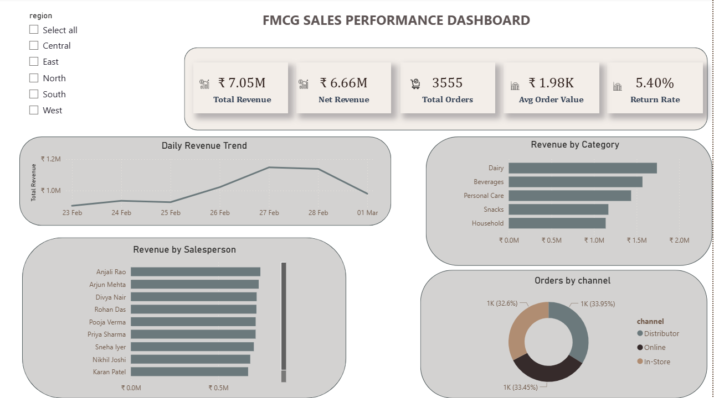

# FMCG Sales Automation Pipeline

> An end-to-end automated daily sales pipeline built with Python, Power Query, Excel VBA, and Power BI: simulating a real-world regional FMCG distributor operation.

---

## Table of Contents

- [Project Overview](#project-overview)
- [Business Context](#business-context)
- [Tech Stack](#tech-stack)
- [Pipeline Architecture](#pipeline-architecture)
- [Project Structure](#project-structure)
- [Features](#features)
- [Data Schema](#data-schema)
- [Simulation vs Real World](#simulation-vs-real-world)
- [Time Savings & ROI](#time-savings--roi)
- [Setup & Usage](#setup--usage)
- [Dashboard Preview](#dashboard-preview)
- [Scope & Scalability](#scope--scalability)

---

## Project Overview

This project automates the daily sales reporting workflow for a regional FMCG distributor. Every day, new sales data arrives as a CSV file. The pipeline automatically ingests it, cleans it, runs an EDA summary, and updates an executive Power BI dashboard — with no manual intervention required beyond opening a file.

The project demonstrates a practical, production-relevant data pipeline using tools that are widely deployed in mid-size retail, FMCG, and distribution companies across India and globally.

---

## Business Context

The simulated business is a regional FMCG distributor operating between manufacturers (Amul, HUL, PepsiCo etc.) and retail outlets. This is how the supply chain works:

```
Manufacturer → Regional Distributor → Retail Outlets (Kirana / Supermarkets) → End Consumer
```

**Scale of operation:**
- 10 field sales representatives covering the country
- 5 regions — North, South, East, West, Central
- 20 cities across all regions
- 300 retail outlet customers (kirana stores, supermarkets, distributors)
- 400–600 orders processed per day
- 5 product categories: Beverages, Snacks, Personal Care, Household, Dairy

Field reps visit retail outlets on fixed routes, take bulk orders, and those orders are fulfilled by the distributor's warehouse. Each order in this dataset represents a retail outlet buying stock to resell to end consumers.

---

## Tech Stack

| Tool | Version | Purpose |
|------|---------|---------|
| Python | 3.x | Daily CSV data simulation |
| Batch File (.bat) | — | Reliable Task Scheduler launcher with correct environment paths |
| Windows Task Scheduler | — | Automates batch file execution daily |
| Microsoft Excel | 2016+ | Power Query pipeline + EDA layer |
| Power Query (M) | — | Data ingestion, cleaning, transformation |
| VBA | — | Auto-refresh, audit logging, PDF export |
| Power BI Desktop | Latest | Executive dashboard + DAX measures |

---

## Pipeline Architecture

```
┌─────────────────────────────────────────────────────────────────┐
│                     DAILY AUTOMATED PIPELINE                    │
└─────────────────────────────────────────────────────────────────┘

  6:30 AM
    │
    ▼
┌──────────────────┐
│  Task Scheduler  │  ──► Triggers run_sales.bat automatically
└──────────────────┘
    │
    ▼
┌──────────────────┐
│  run_sales.bat   │  ──► Sets PYTHONPATH, calls Python with full paths
│  (Batch File)    │       Ensures correct environment every time
└──────────────────┘
    │
    ▼
┌──────────────────┐
│  Python Script   │  ──► Generates sales_YYYY_MM_DD.csv (400-600 rows)
│  (Simulator)     │       Drops file into /daily_sales_data/ folder
└──────────────────┘
    │
    ▼
┌──────────────────┐
│   Excel Opens    │  ──► VBA Workbook_Open event fires automatically
│   (VBA Trigger)  │
└──────────────────┘
    │
    ▼
┌──────────────────┐
│  Power Query     │  ──► Scans folder for new CSVs
│  Pipeline        │       Combines all files into one table
│                  │       Cleans: removes dupes, fixes nulls,
│                  │       removes negatives, calculates revenue
│                  │       Loads clean data → RAW_DATA sheet
└──────────────────┘
    │
    ▼
┌──────────────────┐
│  Excel EDA Layer │  ──► Structured formulas auto-update
│                  │       Overview KPIs, Category, Region,
│                  │       Salesperson, Top Products, Quality Flags
└──────────────────┘
    │
    ▼
┌──────────────────┐
│  LOG Sheet       │  ──► VBA writes timestamped audit entry
│  (VBA Logger)    │       Records rows loaded, return count,
│                  │       data quality metrics per run
└──────────────────┘
    │
    ▼
┌──────────────────┐
│  PDF Export      │  ──► On-demand: EDA sheet exported as
│  (VBA Macro)     │       date-stamped PDF for distribution
└──────────────────┘
    │
    ▼
┌──────────────────┐
│  Power BI        │  ──► One-click refresh updates dashboard
│  Dashboard       │       KPI cards, trend line, category/
│                  │       salesperson breakdown, channel mix
└──────────────────┘
```

---

## Project Structure

```
FMCG_Sales_Project/
│
├── generate_daily_sales.py     # Python data simulator
├── run_sales.bat               # Batch file — called by Task Scheduler daily
│
├── FMCG_Dashboard.xlsm         # Main Excel workbook (macro-enabled)
│   ├── RAW_DATA sheet          # Power Query output — cleaned combined data
│   ├── EDA sheet               # 6-block analysis summary
│   ├── LOG sheet               # VBA audit log
│   └── DASHBOARD sheet         # Placeholder / notes
│
├── FMCG_Dashboard.pbix         # Power BI dashboard file
│
└── daily_sales_data/           # CSV drop folder
    ├── sales_2026_02_23.csv
    ├── sales_2026_02_24.csv
    ├── sales_2026_02_25.csv
    └── sales_YYYY_MM_DD.csv    # New file added daily
```

---

## Features

### Automated Data Ingestion
Power Query connects to the `daily_sales_data` folder as a dynamic source. Any new CSV dropped into the folder is automatically picked up on the next refresh; no manual file selection, no copy-pasting.

### Data Cleaning Pipeline
Every file is cleaned automatically through Power Query's applied steps:
- Duplicate order IDs removed
- Negative quantity rows removed
- Blank customer names filled with `Unknown Customer`
- Missing region values filled with `Unassigned`
- Revenue calculated: `quantity × unit_price × (1 - discount_pct / 100)`
- Net revenue calculated: zeroed out for returned orders

### Audit Logging
After every refresh, a VBA macro writes a timestamped entry to the LOG sheet recording row count, return order count, unknown customers, and unassigned regions. This creates a full run history so anomalies can be spotted immediately.

### EDA Summary Layer
Six structured summary blocks in the EDA sheet pull live from the cleaned data table using Excel structured references (`sales_data[column]`). Everything updates automatically when data refreshes — no manual formulas to update.

### One-Page Executive Dashboard
Power BI dashboard designed for quick executive consumption — 5 KPI cards, daily trend line, category and salesperson breakdown, channel distribution, and a region slicer for instant filtering.



### PDF Export
A VBA macro exports the EDA sheet as a date-stamped PDF on demand, ready to be emailed as a daily report.

---

## Data Schema

Each daily CSV contains 17 columns:

| Column | Type | Description |
|--------|------|-------------|
| order_id | Text | Unique order identifier e.g. ORD-20260301-0001 |
| order_date | Date | Date of order |
| order_time | Time | Time of order (business hours 9AM–8PM) |
| customer_id | Text | Retail outlet ID (pool of 300) |
| customer_name | Text | Retail outlet owner / store name |
| region | Text | North, South, East, West, Central |
| city | Text | One of 20 cities mapped to regions |
| salesperson | Text | One of 10 field sales representatives |
| category | Text | Beverages, Snacks, Personal Care, Household, Dairy |
| product_name | Text | SKU-level product name |
| sku_id | Text | Product code e.g. BEV-001, HH-003 |
| quantity | Integer | Units ordered (bulk, varies by category) |
| unit_price | Integer | Fixed price per unit in INR |
| discount_pct | Integer | Discount: 0, 5, 10, or 15 percent |
| return_flag | Text | Yes / No (~5% return rate) |
| payment_method | Text | Cash, Card, UPI, Credit |
| channel | Text | In-Store, Distributor, Online |

**Calculated columns added by Power Query:**

| Column | Formula |
|--------|---------|
| revenue | `quantity × unit_price × (1 - discount_pct / 100)` |
| net_revenue | `0 if return_flag = Yes, else revenue` |

---

## Simulation vs Real World

### What This Project Uses (Simulation)
A Python script generates synthetic CSV files daily with realistic data distributions:consistent SKUs, a fixed customer pool with repeat buyers, regional city mapping, intentional dirty data injected at ~1–2% to simulate real data quality issues.

Task Scheduler runs the script every morning so a fresh CSV appears in the folder automatically, mimicking the arrival of a real daily sales export.

### How It Works in a Real Deployment
In a real company, the Python simulator would be replaced by an actual data source. The rest of the pipeline: Power Query, Excel, VBA, and Power BI stays exactly the same. The only change is where the CSV comes from:

| Source | How CSV Arrives |
|--------|----------------|
| ERP System (SAP, Tally, Zoho) | Scheduled export dropped into a shared folder or SharePoint |
| Field Sales App | API export or auto-generated report emailed/saved daily |
| POS System | End-of-day transaction export to a network folder |
| Distributor Portal | Manual CSV download by an operations person each morning |

The Power Query folder connection works identically regardless of whether the file was generated by Python or exported by SAP. Drop a file in the folder, open Excel, everything updates. That's the point! The pipeline is source-agnostic.

### What Would Change at Scale
For larger operations or cloud-first companies, the same architecture can be lifted to a cloud stack:

| Current (Local) | Cloud Equivalent |
|----------------|-----------------|
| Local folder | Azure Blob Storage / SharePoint |
| Task Scheduler | Azure Logic Apps / Power Automate |
| Power Query in Excel | Power Query in Dataflows (Power BI Service) |
| Manual Power BI refresh | Scheduled refresh in Power BI Service |
| PDF emailed manually | Power Automate sends PDF automatically |

The logic, cleaning steps, and DAX measures are fully portable. The architecture scales up without being rewritten.

---

## Time Savings & ROI

For a company currently doing this reporting manually, here is a realistic estimate of time saved:

| Task | Manual Process | With This Pipeline |
|------|---------------|-------------------|
| Collect and consolidate daily CSVs | 15–20 min/day | 0 — automated |
| Clean data (remove dupes, fix blanks, handle returns) | 20–30 min/day | 0 — Power Query |
| Update summary tables and KPIs | 15–20 min/day | 0 — live formulas |
| Build or update charts for management | 20–30 min/day | 0 — Power BI refresh |
| Export and format daily PDF report | 10–15 min/day | < 1 min — one macro run |
| **Total per day** | **80–115 minutes** | **< 5 minutes** |
| **Total per month (22 working days)** | **~30–40 hours** | **< 2 hours** |

Beyond time savings:
- **Consistency** — the same cleaning logic runs every day with no human error variation
- **Audit trail** — every run is logged with row count and quality metrics
- **Scalability** — adding a new region or product category requires updating the simulator only, the pipeline handles it automatically
- **Reliability** — a new analyst can open the file and get accurate data without knowing how it was built

---

## Setup & Usage

### Prerequisites
- Python 3.x with `pandas` and `numpy` installed
- Microsoft Excel 2016 or later (macro-enabled)
- Power BI Desktop (free from Microsoft)

### Installation

**1. Clone the repository**
```bash
git clone https://github.com/yourusername/fmcg-sales-automation.git
cd fmcg-sales-automation
```

**2. Install Python dependencies**
```bash
pip install pandas numpy
```

**3. Generate initial data (7 days backfill)**

Open `generate_daily_sales.py` and run it once for each date you want, or run it as-is to generate today's file:
```bash
python generate_daily_sales.py
```

**4. Create the batch file**

Create `run_sales.bat` in your project folder with this content:
```batch
@echo off
set PYTHONPATH=D:\Lib\site-packages
D:\python.exe "D:\FMCG_Sales_Project\generate_daily_sales.py"
```
Update the Python path to match your own installation (find it by running `python -c "import sys; print(sys.executable)"` in your terminal).

**5. Set up Task Scheduler (Windows)**
- Open Task Scheduler → Create Basic Task
- Trigger: Daily at your preferred time
- Action: Start a program → select `run_sales.bat`
- Start in: path to your project folder
- General tab → set to run as your Windows username, "Run only when user is logged on"
- Conditions tab → uncheck "Start only if on AC power"

**6. Open Excel workbook**
- Enable macros when prompted
- Power Query will auto-refresh and load all CSVs from the folder
- Check the LOG sheet to confirm the run was recorded

**7. Open Power BI**
- Open `FMCG_Dashboard.pbix`
- Home → Refresh to load latest data from Excel

### Daily Usage
```
Morning:
  → Task Scheduler runs Python at set time (automatic)
  → Open FMCG_Dashboard.xlsm (auto-refresh triggers)
  → Open Power BI → click Refresh
  → Optional: ALT+F8 → ExportPDF for daily report
```

---

## Dashboard Preview

The Power BI dashboard is a single executive-focused page containing:

- **5 KPI Cards** — Total Revenue, Net Revenue, Total Orders, Avg Order Value, Return Rate
- **Line Chart** — Daily revenue trend across the date range
- **Bar Chart** — Revenue by product category (sorted descending)
- **Bar Chart** — Revenue by salesperson (performance ranking)
- **Donut Chart** — Order distribution by sales channel
- **Region Slicer** — Filter entire dashboard by North / South / East / West / Central

---

## Scope & Scalability

### Who This Is Built For
Mid-size FMCG distributors, retail chains, and regional sales operations that:
- Receive daily sales exports from field teams or ERP systems
- Need management reporting without a dedicated data engineering team
- Run on Excel-based workflows and want to automate without migrating to a full cloud stack

### Current Scope
- 7+ days of daily data, growing daily
- 17 columns, 400–600 rows per day (~3,500+ rows after 7 days)
- 5 regions, 20 cities, 10 salespersons, 5 categories, 30 SKUs
- Single Excel workbook with full Power Query + VBA automation
- Single-page Power BI dashboard

### Natural Extensions
- Add a weekly or monthly aggregation sheet for trend analysis
- Add a salesperson target vs actuals comparison using a targets table
- Connect Power BI to the folder directly instead of via Excel for faster refresh
- Publish to Power BI Service for scheduled cloud refresh and mobile access
- Add email automation via Power Automate to send the PDF report automatically
- Extend to multiple distributors or territories by adding a region identifier column

---

## Author

Built as a portfolio project demonstrating end-to-end data pipeline automation using the Microsoft Excel and Power BI ecosystem.

Tools used: Python · Power Query (M) · Excel VBA · DAX · Power BI Desktop

---

*This project uses simulated data. No real company data is included.*
